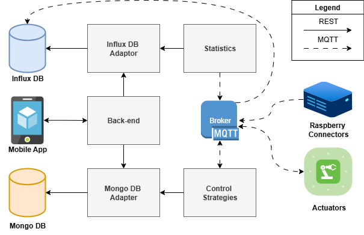

# GreenBox
**IoT Software Ecosystem for Smart Greenhouse Management**

GreenBox is a comprehensive, **microservices**-based **IoT platform** designed to automate and optimize the climate control of smart greenhouses. It integrates real-time monitoring, intelligent control strategies, and resource management into a scalable architecture.

The user interface is a **React Native** mobile application that allows real-time monitoring of greenhouse states, strategy management, and user profile control. The source code is available in the [GreenBoxApp repository](https://github.com/The-Green-Box-IoT-Project/GreenBoxApp).

## 🏗 Architecture Overview

The system is built on a distributed microservices architecture, communicating via **MQTT** for real-time operations and **REST APIs** for configuration and historical data access.

### 🔌 Devices Layer
The physical (or simulated) world of the greenhouse.
- **Sensors (`/devices/raspberry`)**: Acts as a hub (Raspberry Pi) collecting data from sensors (Temperature, Humidity, Soil Moisture, Light, pH).
  - *Simulation*: Includes a sophisticated **MockSeries** generator that produces realistic sensor data with daily/yearly seasonality and noise.
- **Actuators (`/devices/actuators`)**: Controls hardware like Lights, Pumps, Fans, and Heaters.
  - They listen for MQTT commands, execute actions, and report their status and resource consumption (Energy, Water).

### 📦 Microservices
The backend logic is divided into specialized services:

1.  **Catalog Service (`/microservices/catalog`)**
    -   **Role**: System Registry and API Gateway.
    -   **Description**: It manages the logical structure of the system (Users, Greenhouses, Zones, Devices) and exposes a REST API for configuration. It acts as the primary entry point for frontend applications to retrieve system metadata.
    -   **Tech**: CherryPy, REST API.

2.  **Controller Service (`/microservices/controller`)**
    -   **Role**: Control Logic & Optimization.
    -   **Description**: It subscribes to aggregated zone states and calculates actuator commands.
        -   **Optimization**: Uses a multi-objective algorithm to minimize resource consumption (Water, Energy) while satisfying environmental constraints.
        -   **Reactive**: Maintains a local cache of control strategies and updates them immediately upon receiving specific MQTT events, avoiding database polling.
    -   **Tech**: Python, MQTT, Pandas, Scipy.

3.  **Mongo Adapter (`/microservices/mongo`)**
    -   **Role**: Metadata Persistence & Notification.
    -   **Description**: Manages CRUD operations for **MongoDB** (Users, Strategies, Greenhouses). Crucially, it includes a **Notifier** that broadcasts an MQTT event (`/zones/+/strategy/updated`) whenever a control strategy is modified via API, allowing the Controller to apply changes in real-time.
    -   **Tech**: MongoDB, MQTT.

4.  **Statistics Service (`/microservices/statistics`)**
    -   **Role**: Data Aggregation & Stabilization.
    -   **Description**: Decouples high-frequency sensor readings from control logic. It periodically fetches raw data, filters noise by calculating aggregates (e.g., median over a time window), and publishes a stable "Zone State" message via MQTT for the Controller.
    -   **Tech**: Python, InfluxDB, MQTT.

5.  **Influx Adapter (`/microservices/influx`)**
    -   **Role**: Time-series Persistence & Visualization.
    -   **Description**: Handles the storage of sensor measurements and actuator consumption logs into **InfluxDB**. It is integrated with **Grafana**, which serves as the system's visualization UI to create monitoring dashboards for the entire infrastructure or specific clients.
    -   **Tech**: InfluxDB 3.0, Telegraf, Grafana, MQTT.

## 📡 Data Flow

1.  **Sensing**: Devices publish raw sensor data to MQTT.
2.  **Aggregation**: The **Statistics Service** aggregates this data and publishes a `state` message for each zone.
3.  **Decision**: The **Controller** receives the state, evaluates it against the user-defined **Strategy** (stored in Catalog/Mongo), and calculates the optimal actuator commands.
4.  **Actuation**: Commands are sent via MQTT to **Actuators**, which adjust their state (e.g., turn on pump) and report consumption.
5.  **Storage**: All data is persisted in InfluxDB (measurements) and MongoDB (configuration).

## 🛠️ Installation & Setup

The system is designed with a hybrid deployment model in mind:

1.  **Microservices (Dockerized)**: The backend logic (Catalog, Controller, Adapters, Statistics) is fully containerized. You can launch the entire stack using `docker-compose`.
2.  **Devices (Local Execution)**: To simulate the distributed nature of IoT, the sensor hubs (Raspberry Pi) and Actuators are designed to run as standalone Python processes (e.g., in separate terminals or environments).
    - Each device type has its own `config.json` (or environment variables) to define its ID, associated sensors, and connection details.

### Prerequisites
- Docker & Docker Compose
- Python 3.10+ (for running devices)

### Running the System
1.  **Start the Backend**: Navigate to the microservices directories and run `docker-compose up`.
2.  **Start Devices**: Run the device scripts (`devices/raspberry/runner.py`, `devices/actuators/runner.py`) from your terminal. Ensure their configuration files point to the correct Catalog/Broker addresses.

All internal system activity and events are recorded in the `logs/` directory for developer monitoring and debugging.

## 🧫 Simulation Mode
The project features a robust built-in simulation engine (`devices/sim`):
-   **Environmental Data**: `mockseries.py` generates realistic, time-variant sensor data (with daily/yearly seasonality and noise) to mimic a real greenhouse.
-   **Actuator Physics**: The effects of actuators on the environment (e.g., a heater raising temperature) and their resource consumption (Energy, Water) are simulated based on the `effects/effects.csv` model. This allows for closed-loop control testing without physical hardware.